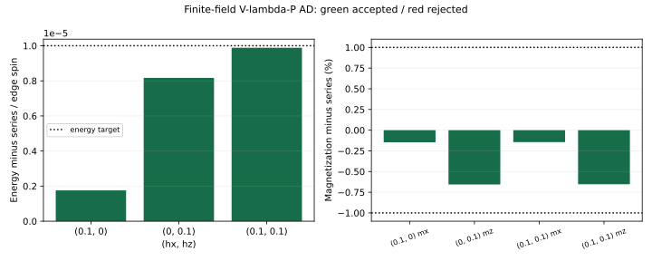

# 有限场阶段总结：弱场已有成功，完整路径仍待完成

**Loop/cluster update 已在三个弱场点得到基态近似，split AD 也在这三个点达到预定精度。接下来沿主轴继续计算更大磁场，再完成显式虚拟 Z₂ 约束和转移矩阵不同 sector 的谱。**

采用 H=−ΣA−ΣB−hₓΣX−h_zΣZ，Jₑ=Jₘ=1，Pauli convention，无限方格、edge 自旋。Loop 和 split AD 使用2×2顶点测量布局，one-site/C₄/Z₂ AD 在该布局内共享同一组张量。主观测量是每 edge 自旋能量 e、磁化 mₓ/m_z，以及每个位置的 stabilizer。

## Loop/cluster update：当前主要方法

算法在场项半步之间执行 star 与 plaquette 更新：star 使用四臂 HOSVD，plaquette 使用完整八张量环的 ALS 拟合与 λ 重新分配。更新不使用 CTMRG；CTMRG 仅测量已有张量。三个 D=2 场点从同一组随机张量分别开始，D=3/4 则从对应较小 D 的结果增大连接维数继续计算。

| (hₓ,h_z) | D | e | 非零磁化误差 | 判断 |
|---|---:|---:|---|---|
| (0.1,0) | 2 | −1.002522276336 | mₓ约 −0.143% | 达到弱场精度 |
| (0,0.1) | 2 | −1.002515800057 | m_z约 −1.164% | 磁化未到 1% |
| (0.1,0.1) | 2 | −1.005034764851 | mₓ约 −0.139%，m_z约 −1.159% | Z 磁化未到 1% |
| (0,0.1) | 3 | −1.002519829374 | m_z约 −0.773% | 达到目标，χ=8/12 一致 |
| (0.1,0.1) | 3 | −1.005038775468 | mₓ约 −0.139%，m_z约 −0.770% | 达到目标，有独立 VUMPS 测量支持 |
| (0.1,0) | 3 | −1.002522762082 | mₓ约 −0.068% | 局部拟合和更大 χ 问题未解决，暂列待定 |
| (0.1,0.1) | 4 | −1.004887477064 | mₓ约 +4.55%，m_z约 −1.85% | 短计算未完成可靠优化，不接受 |

采用的精度目标是能量偏差≤10⁻⁵/spin、非零磁化相对偏差≤1%。D=2 双分量点将 dt 减半或 ALS 上限加倍后，Z 磁化偏差仍约 1.16%。D=4 只完成了短计算，尚待进一步优化。

参考来自 arXiv:1012.1740v2 补充材料十阶低场能量及其磁化导数，换算到 J=1。三个点的级数数值和阶数敏感性见 [model/reference.jl](model/reference.jl)、[reference_values.csv](simple-update/loop/reference_values.csv)。

## AD：三个弱场点的结果

Split AD 直接优化 V/P/λ。当前成功计算从解析零场或已有近基态出发，使用 unrolled AD，对固定次数的 CTMRG 迭代求导，并检查有限差分与迭代次数稳定性，得到下表结果：

| (hₓ,h_z) | e_AD | e_AD−e_series | mₓ | m_z |
|---|---:|---:|---:|---:|
| (0.1,0) | −1.002522276338 | +1.76×10⁻⁶ | 0.050899301286 | ≈0 |
| (0,0.1) | −1.002515864507 | +8.17×10⁻⁶ | ≈0 | 0.050639421385 |
| (0.1,0.1) | −1.005034828796 | +9.88×10⁻⁶ | 0.050830793213 | 0.050571570924 |

三点均满足能量 10⁻⁵/spin、磁化 1% 及相应的优化、收缩检查。从解析零场分别重新启动的完整四点批次也通过；随机全局寻优尚未通过。双分量能量误差约 9.88×10⁻⁶/spin，接近目标上限。所选数值来源见 [ad/split/selected_fields.json](ad/split/selected_fields.json)，细节见 [AD 报告](ad/split/REPORT.md)。

Loop 和 AD 的张量参数共享方式与起点不同。后续可从同一个 loop 态出发，在相同自由度下用 AD 继续优化，比较局部更新带来的误差。

## One-site/C₄/Z₂ AD：两类初态的结果

显式施加 one-site 平移、C₄ 和虚拟 Z₂ 的实现位于 [ad/one-site-c4-z2/](ad/one-site-c4-z2/README.md)，与上面的 split AD 结果分别记录。当前场点为 $(h_x,h_z)=(0,0.1)$、D=4。

| 初态来源 | 最好能量 | 与级数参考的差 | 当前判断 |
|---|---:|---:|---|
| 零场解析态加幅度0.03的对称扰动 | −1.002515869800994 | +8.16×10⁻⁶ | 梯度约4.14×10⁻⁶；χ=8 的三环境测量一致；较大χ旧高精度环境检查未通过，保留候选态身份 |
| 任意随机初态，多 seed | −0.767072187272608 | +0.235452 | 未收敛、未达到10⁻⁴能量目标；随机路线已停止 |

解析来源候选态的 $m_z=0.0506384111124$，相对级数约偏低0.66%，$\langle B_p\rangle\approx0.9999999972$。χ=16 的 CTMRG 残差在约 $10^{-9}$ 出现平台，延长迭代时能量与局部物理量已非常稳定；残差不等于能量误差，原始接受标记保持不变。各随机 seed 及解析来源测量的完整汇总见[AD报告](ad/one-site-c4-z2/REPORT.md)，不再把随机寻优诊断列为后续任务。

固定上述解析来源候选态的四sector谱已重算完成：χ=8边界MPS、64动量、每sector8模，共2048点；另完成χ=12在三个共同动量的96点比较。实际约30.4分钟，以定性谱结构为目标，未重跑AD。e、m、ε主导模在已比较动量上稳定，平凡sector及高支仍有χ依赖，见[谱结果](transfer-spectrum/REPORT.md)。输入不来自随机优化结果。

## 收缩问题与下一步

同一张量曾得到多个环境解。对保存的 D=3 双分量态，先平衡 λ 而保持物理态不变，再分别求上下 boundary-VUMPS；主要观测量与此前 CTMRG 的差不超过约 1.25×10⁻¹¹。两种收缩都得到约 0.77% 的 Z 磁化偏差。

D=4 的较大 χ、上下 norm 一致性和原态优化均未得到充分控制，换用 VUMPS 没有使它通过。两种边界方法及有限周长圆柱的区别见 [VUMPS_REPORT.md](simple-update/loop/VUMPS_REPORT.md)。

项目总体安排见 PLAN。对 one-site/C₄/Z₂ AD，后续重点从零场解析态出发优化弱场基态，再考虑相邻磁场点；随机全局寻优已停止。所需收缩精度应服务于物理量目标，不把极紧的环境奇异值残差作为能量精度的直接替代。本次文件整理不启动新的物理计算。
