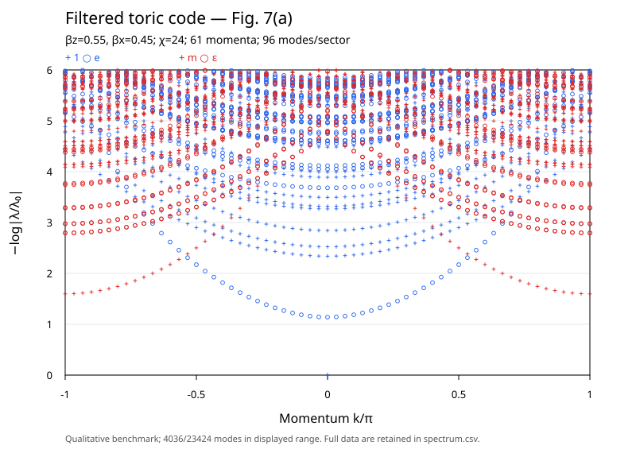

# Fig. 7(a) 复现结果

**已完成 Fig.7(a) 的定性复现。** 最终采用χ=24、61个动量、每sector96模，得到23424个谱值，其中4036个落在论文图示范围 $0\le\varepsilon\le6$。

## 图中的物理结构

输入为 $(\beta_z,\beta_x)=(0.55,0.45)$ 的解析过滤态，采用 [README](README.md) 从 V/P 网络推导的四自旋对角 blocking。k 是沿块晶格边界的动量；蓝/红表示扰动两侧使用相同/不同的 fixed points（g=0/1），后者构成 domain wall；加号/空心圆表示 ket、bra 同时进行虚拟 Z₂ 变换时的偶/奇 charge（q=0/1）。红色背景采用与论文相容的逐格相位约定，其最低点位于 $k=\pm\pi$。

两个孤立低支的最低谱量为 $\Delta_e=1.13876624$、$\Delta_m=1.59674072$，对应论文中约1.1和1.6的蓝色空心圆与红色加号低支。平凡sector与ε sector的密集谱区间低端分别约为2.33806和2.79422。图中同时呈现孤立色散支、较高的密集变分能级以及 $k=0$ 的归一化固定点。

此前轴向两自旋 blocking 的低能谱量不同；本次图按对角块晶格的动量与转移步长绘制。论文没有提供这张图的原始数值，本轮目标是复现其可见低能结构和密集谱区间。高支的离散能级会随边界维数和激发变分空间变化，图中各动量按模长排序的序号不表示已经追踪的同一物理分支。

## 参数选择与实际开销

三组计算均用 VUMPS 求一个边界 fixed point $r_0$，再在每个边界位点的 ket 虚拟指标上作用 Z₂ 生成元，得到另一个 fixed point $r_1$。求边界时 `--tol=1e-6` 控制环境收缩的迭代精度，VUMPS 内部停止目标取其十分之一；构造激发有效转移作用时，`--spectrum-tol=1e-7` 控制无限环境及相关线性方程的求解精度。

最终χ=24的局部 Galerkin residual 约为 $1.52\times10^{-8}$，衡量边界固定点方程的局部自洽程度。对每个谱解，重新计算归一化参数向量 b 的本征方程残差 $\|T_{\rm eff}b-\eta b\|$；所有动量和 sector 中的最大值约为 $1.29\times10^{-7}$。这些数值的具体定义见 [README 第4节](README.md#4-精度参数和输出数值是什么意思)。有限χ带来的谱变化通过下面三组计算比较。

| 边界χ | 动量数 | 每sector模数 | 总谱值数 | 图示范围内模数 | 实际运行时间 |
|---|---:|---:|---:|---:|---:|
| [8](results/fig7a-chi8/figure7a.svg) | 41 | 24 | 3936 | 1459 | 150秒 |
| [16](results/fig7a-chi16/figure7a.svg) | 41 | 64 | 10496 | 2445 | 370秒 |
| [24](results/fig7a-chi24/figure7a.svg) | 61 | 96 | 23424 | 4036 | 1757秒 |

χ=8时，每个动量、sector在ε≤6内只有2～14模，尚未达到24模输出上限；因此增加输出数量不能填密该区间，需要增大χ以扩大变分空间。χ=24时该范围内每类有8～30模，仍未达到96模输出上限。图形所需的低端谱已包含在保存的数据中。

三个χ下的 e、m 谱隙分别保持在1.13877、1.59674附近，差异约10⁻⁷。平凡sector最低谱量依次为2.37747、2.33756、2.33806；ε sector依次为2.83480、2.79733、2.79422。χ=16→24的这两个低端变化分别约0.00050和0.00311，满足本次定性比较的需要。

三组实际运行时间合计约38分钟，包含程序编译、计算和输出，均使用本地单线程；进程物理内存使用峰值（RSS）最高约2.76 GiB。若只想快速学习或改变参数，χ=8的默认命令即可；复现本报告主图使用χ=24。

## 数据和程序

最终数据位于 [`results/fig7a-chi24/`](results/fig7a-chi24/)：`spectrum.csv` 保存全部模式，`settings.json` 保存参数和几何约定，`tensor.json`、`boundary.json` 保存解析张量和数值边界，`run.log` 保存进度，`source/` 保存实际运行代码与环境。图仅截取ε≤6，CSV保留图外模式。

本目录的三个程序文件是 `tensor.jl`、`run.jl`、`plot.py`，共用 `transfer-spectrum/numerics.jl` 加载的数值主干。`results/` 记录χ=8、16、24三组结果。
