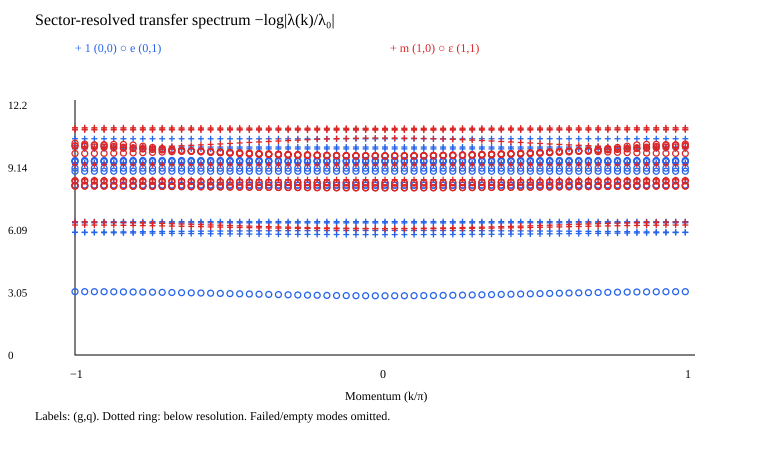

# 解析来源有限场张量的转移谱

## 研究对象与计算状态

输入为无限平方晶格 Toric Code 在 $(h_x,h_z)=(0,0.1)$ 的 D=4、one-site/C₄/Z₂ PEPS；物理自旋位于 edge，采用 Pauli convention、$J_e=J_m=1$。零场解析态嵌入D=4并加入幅度0.03、seed=71的对称小扰动后，通过AD优化得到冻结张量，见[AD报告](../ad/one-site-c4-z2/REPORT.md)。本轮不改变该张量，也不重启优化。

输入能量为 $-1.002515869800994$/edge spin，与十阶低场级数相差约 $8.16\times10^{-6}$，约束梯度范数约 $4.14\times10^{-6}$。历史较大χ CTMRG检查未达到其严格残差要求，原文件中的 `accepted=false` 保留。这不妨碍计算该固定近似态的谱，但不应把谱求解完成当作重新验收了基态。

**本轮计算已完成。** 结果目录为 `results/analytic-hz01-chi8-nk64/`：χ=8边界MPS、64动量、每sector8模，共2048个本征值；另完成χ=12在 $k=0,\pi/2,-\pi$ 的比较，共96个本征值。实际运行1822秒（约30.4分钟），峰值进程内存约2.19GB，未用完两小时预算，也未自动扩大计算范围。主谱与比较谱的全部点均通过所设投影残差要求，最大残差分别为 $4.72\times10^{-11}$、$7.26\times10^{-11}$。冻结输入与AD原文件逐字节一致。

[主图SVG](results/analytic-hz01-chi8-nk64/figures/figure7.svg)；[本征值模长图](results/analytic-hz01-chi8-nk64/figures/rho.svg)。`spectrum.csv`/JSONL保存主谱，`comparison-chi12.csv`/JSONL保存较大χ比较，`chi-comparison.json`保存按模长排序的差异。设置、边界、输入、实际运行源码和日志分别保存在 `settings.json`、`boundaries*.json`、`input.json`、`source/`、`run.log`；最终状态见 `summary.json`。

## 主要结果与χ依赖

在χ=8的64动量网格上，e sector最低谱量约2.88659，位于k=0；平凡sector最低谱量约5.86863，位于k=0；m sector最低谱量约6.15731，网格最低点位于 $k/\pi=-0.09375$；ε sector最低谱量约8.14922，位于k=0。m支很浅且这里只检查有限动量和χ，不能据此给出精确的最低点位置。

下表比较三个共同动量上的 $|\varepsilon_{\chi=12}-\varepsilon_{\chi=8}|$ 最大值。主导模指该sector、该动量下模长最大的本征值；“全部8模”按模长排序逐项配对。

| sector | 主导模最大变化 | 全部8模最大变化 |
|---|---:|---:|
| 1 | 0.0628 | 3.55 |
| e | $6.23\times10^{-8}$ | 0.530 |
| m | $4.33\times10^{-7}$ | 0.0568 |
| ε | $1.20\times10^{-5}$ | 0.414 |

**e、m、ε主导模在已比较动量上稳定，平凡sector及较高谱支仍有明显χ依赖。** χ=12在k=0的平凡sector最低谱量降到约5.80582。因而本图适合查看定性谱形及任意子sector的低支，不应把所有点理解成已χ收敛的精确谱。表中差异也可能包含模式重排，不能直接解释成某条连续物理分支的误差。

两种χ的边界都满足本轮条件：主本征值密度约0.4977904747，单层作用前后两背景的每格重叠约0.00947，对角Z₂作用后的每格重叠接近1。χ=8/12的最大边界投影残差分别约 $3.60\times10^{-7}$、$4.33\times10^{-8}$。这些结果与预期的两背景解释相容，但不是对所有可能边界的穷尽搜索。

## 谱的含义与精度范围

V/P/λ精确合并为含东、北两条边自旋的轴向块，再构造普通双层行MPO。边界用无限MPS近似，左右背景相同或由单层虚拟Z₂连接，分别标记g=0/1；ket–bra对角Z₂ charge标记q=0/1。在拓扑相的两背景解释下，四sector依次为 $1,e,m,\epsilon$。

图中谱量为 $\varepsilon(k)=-\log|\lambda(k)/\lambda_0|$，不是Hamiltonian激发能量。k对应沿原顶点晶格边界平移一个块，周期 $2\pi$；与采用对角四自旋块的filtered-Toric-Code benchmark相比，晶格步长与张量表示不同，不能直接把数值逐点等同。

每个动量构造完整的one-site准粒子有效矩阵并对角化，按模长保存前8模，保留简并重数。各动量独立排序，没有通过本征态重叠追踪连续分支。残差检验只针对这个有限χ变分空间内的本征方程；高支可能随χ明显变化。本轮以低支和整体谱形为目标，不要求全部高支严格χ收敛。χ比较中的差异按同一sector、同一动量的模长排序配对，并非严格的物理分支匹配。

默认边界容差 $10^{-6}$、固定点一致性容差 $10^{-5}$、激发环境容差 $10^{-10}$、投影残差容差 $10^{-7}$；这组容差未被当作物理误差界。旧计算在更松激发环境容差下曾有domain-wall gauge差异，故本轮仍保留较紧的环境求解，未重复一套独立gauge验收。

运行命令、数学步骤与文件阅读顺序见 [README](README.md)。旧谱及一次性检查的八个目录已由本轮结果替代并删除，不增加旧结果归档；AD输入与独立benchmark结果保留。

计算完成后，当前 `run.jl` 修正为每个sector完成即写盘，避免后续sector超时时丢失当前动量已完成的结果；用模拟后续sector超时的小型检查复现问题并确认修复。`source/run.jl` 仍是本次实际运行版本，其哈希不改写。本轮完整完成，未触发该保存问题；保存修正不涉及数学求解器，也没有因此重算谱。
